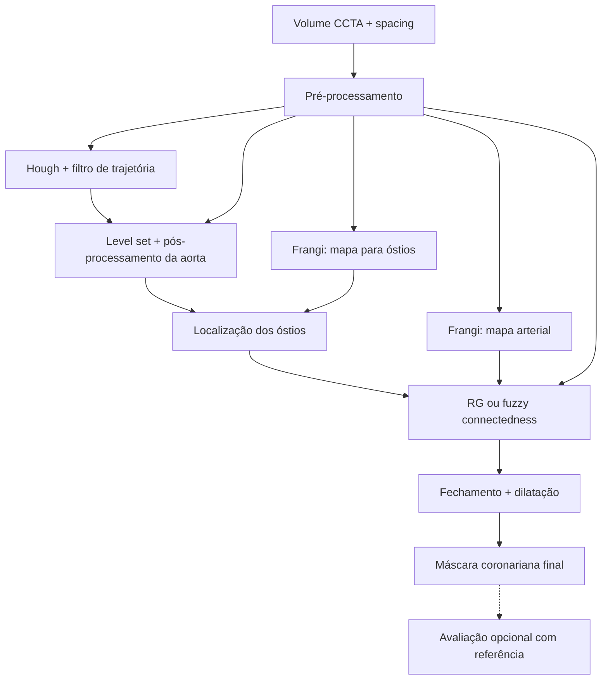

# Manual do pipeline para desenvolvedores

[README do projeto](../../README.md) · [Parâmetros da configuração](../../config/README.md)

Este manual ensina a usar as funções existentes para processar CCTA, localizar/segmentar a aorta, localizar os óstios e segmentar as coronárias. O foco é a API Python: propósito, entradas, parâmetros, exemplos, saídas e falhas. A extração de linhas centrais ainda não integra o fluxo aqui documentado.

## Percurso de leitura

| Etapa | Manual | Entrada → saída |
|---|---|---|
| 01 | [Pré-processamento](01_preprocessamento/README.md) | CCTA/spacing → imagem de trabalho, máscaras e spacing reduzido. |
| 02 | [Mapa de vasos](02_mapa_vasos/README.md) | Imagem de trabalho → mapas para óstios e coronárias. |
| 03 | [Localização da aorta](03_localizacao_aorta/README.md) | Imagem de trabalho → trajetórias circulares original e filtrada. |
| 04 | [Segmentação da aorta](04_segmentacao_aorta/README.md) | Imagem + círculos → máscara da aorta e diagnósticos. |
| 05 | [Localização dos óstios](05_localizacao_ostios/README.md) | Máscara da aorta + mapa de vasos → sementes coronarianas. |
| 06 | [Segmentação coronariana](06_segmentacao_coronarias/README.md) | Sementes + mapa arterial → máscaras por RG ou FC. |
| 07 | [Pós-processamento e avaliação](07_posprocessamento_avaliacao/README.md) | Máscara bruta → estágios morfológicos e métricas opcionais. |

A Hough e o level set recebem a **imagem pré-processada**, diretamente. O mapa configurado como VESSELNESS_AORTA é usado para localizar os óstios na superfície da aorta; VESSELNESS_ARTERY é usado na segmentação coronariana. A localização da aorta e o primeiro mapa podem ser calculados independentemente a partir da mesma imagem.



As funções arteriais de alto nível já incluem fechamento e dilatação no retorno. O diagrama separa essas operações para mostrar seu papel, sem exigir uma segunda aplicação.

## Preparação do ambiente

Execute os comandos na raiz do repositório. O projeto usa Python >=3.13 e o ambiente definido em pyproject.toml/uv.lock:

```bash
uv sync
PYTHONPATH=src uv run python seu_exemplo.py
```

Salve o bloco desejado em um arquivo e execute com o segundo comando. Não é necessário instalar o projeto como pacote para importar utils quando PYTHONPATH=src está definido. Os exemplos sintéticos de cada página são independentes entre páginas; os blocos de referência daquela página continuam seu exemplo inicial.

O ambiente declara dependências CUDA, mas os exemplos solicitam CPU explicitamente. O módulo de GPU pode emitir um aviso de indisponibilidade durante o import mesmo quando a execução pretendida é CPU. O Frangi tem fallback CPU; Hough, os wrappers de aorta e a morfologia final do pipeline permanecem na CPU.

Para acompanhar um exame real interativamente, consulte [main.ipynb](../../src/main.ipynb) para ImageCAS e [external_ccta_pipeline.ipynb](../../src/external_ccta_pipeline.ipynb) para MM-WHS/OrCaScore. O [catálogo EDA](../../src/eda/README.md) descreve as análises separadamente.

## Configuração: carregar, normalizar e escalar

O arquivo de referência é [pipeline_config.json](../../config/pipeline_config.json). Seus valores espaciais são definidos para mid. Carregue-o, selecione os fatores desejados e só então aplique a escala:

```python
import numpy as np
from utils.project.config import load_config_json, scale_config_to_resolution

config = load_config_json("config/pipeline_config.json", {})
config["USE_GPU"] = False
config = scale_config_to_resolution(config)

assert config["DOWNSCALE_FACTORS"] == (2, 2, 1)
print(config["LEVEL_SET"]["num_iter"])  # 26 em mid com o JSON de referência
```

Para high, use fatores (1, 1, 1) **antes** de scale_config_to_resolution. Não passe uma configuração já escalada novamente por essa função: isso pode multiplicar raios, margens e limites outra vez. Os wrappers por etapa esperam configuração efetiva; não executam esse ajuste por conta própria.

As tabelas das funções mostram seus defaults locais; as tabelas de configuração mostram os valores do JSON de referência. Eles não são necessariamente iguais. Snapshots de execuções antigas também podem diferir. Não misture automaticamente parâmetros históricos com a configuração atual.

### Referência da preparação

### `load_config_json`

Lê JSON, mescla recursivamente com a base e normaliza tipos de runtime. Não aplica escala de resolução.

Importação: `from utils.project.config import load_config_json`.

```text
load_config_json(path, base_config)
```

| Parâmetro | Tipo | Obrigatório / padrão da função | Unidade e efeito |
|---|---|---|---|
| `path` | `str ou Path` | Sim | Caminho do JSON, relativo ao diretório de execução ou absoluto. |
| `base_config` | `dict` | Sim | Dicionário base; {} lê somente o conteúdo do arquivo. A mesclagem não modifica a base. |

**Saída:** Dict independente da base, com fatores/offsets convertidos para tuplas e sigmas para arrays NumPy.

```python
loaded = load_config_json("config/pipeline_config.json", {})
assert isinstance(loaded["VESSELNESS_AORTA"]["sigmas"], np.ndarray)
```

### `normalize_runtime_config`

Normaliza um dicionário já carregado de JSON; load_config_json faz isso internamente.

Importação: `from utils.project.config import normalize_runtime_config`.

```text
normalize_runtime_config(config)
```

| Parâmetro | Tipo | Obrigatório / padrão da função | Unidade e efeito |
|---|---|---|---|
| `config` | `dict` | Sim | Dicionário de configuração carregado de JSON, antes da normalização de tipos. |

**Saída:** Cópia normalizada; não escala os parâmetros e não completa todas as chaves ausentes.

```python
from utils.project.config import normalize_runtime_config

normalized = normalize_runtime_config({"DOWNSCALE_FACTORS": [2, 2, 1]})
assert normalized["DOWNSCALE_FACTORS"] == (2, 2, 1)
```

### `scale_config_to_resolution`

Adapta parâmetros definidos para mid (fator XY=2) ao fator de trabalho. Retorna cópia; não reamostra o volume.

Importação: `from utils.project.config import scale_config_to_resolution`.

```text
scale_config_to_resolution(config, reference_downscale_xy=2, enabled_groups=None)
```

| Parâmetro | Tipo | Obrigatório / padrão da função | Unidade e efeito |
|---|---|---|---|
| `config` | `dict` | Sim | Configuração normalizada, ainda sem escala, com DOWNSCALE_FACTORS já escolhido. |
| `reference_downscale_xy` | `float` | `2` | Fator XY de referência da configuração de entrada; 2 representa mid. |
| `enabled_groups` | `iterável de str ou None` | `None` | None ativa todos os grupos; subconjunto de RESOLUTION_SCALING_GROUPS limita o ajuste. Grupo desconhecido gera ValueError. |

**Saída:** Configuração efetiva com geometria, morfologia e heurísticas ajustadas pelos grupos ativos.

```python
unscaled_high = load_config_json("config/pipeline_config.json", {})
unscaled_high["DOWNSCALE_FACTORS"] = (1, 1, 1)
high_config = scale_config_to_resolution(unscaled_high)
assert high_config["LEVEL_SET"]["num_iter"] == 70
```

A função usa o primeiro fator para determinar a escala XY; não é um reescalonador geral independente por eixo. Mudar fatores após escalar torna a configuração inconsistente. Para outra resolução, recarregue o JSON original e aplique uma única vez.

## Convenções de dados

| Informação | Contrato |
|---|---|
| Volume | Array 3D; eixo 2 é z/fatia. O pré-processamento declara layout (x, y, z). As rotinas geométricas chamam eixo 0 de linha/y e eixo 1 de coluna/x. Não transponha arrays para conciliar apenas os nomes. |
| Coordenadas de óstios/sementes | Índices diretos (eixo 0, eixo 1, z), chamados (y, x, z) nos módulos de óstios/artérias. Indexe com volume[tuple(coordenada)]. |
| Círculos | center_x é coluna/eixo 1; center_y é linha/eixo 0; radius em pixels; slice_index indexa eixo 2. |
| Espaçamento | Pré-processamento retorna spacing original e scaled_spacing = spacing × fatores. Funções diretas de óstios recebem (dy, dx, dz); o wrapper detect_ostia troca as duas primeiras entradas internamente. |
| Intensidade | HU para CCTA; lcc_image preserva HU na região e usa -offset no fundo nos modos normal/fuzzy. Mapa de vasos é resposta numérica, não HU ou probabilidade calibrada. |
| Máscaras | Normalmente 0/1 uint8; intermediárias de seleção podem ser bool. Label coronariano ImageCAS é convertido com label == 1. |
| Geometria | Todas as entradas de uma etapa precisam estar na mesma resolução, orientação e geometria. Shape compatível sozinho não garante alinhamento anatômico. |

Os helpers NIfTI não reorientam automaticamente a aquisição. Para OrCaScore, a preparação externa existente inclui alinhamento visual (inversão do eixo 1) com `align_ccta_volume_to_imagecas_view`, aplicado depois de carregar em XYZ. Use o notebook externo como referência para carregar/alinhar imagem e referências; não aplique esse flip indiscriminadamente a outros volumes.

A classificação esquerda/direita e o quadrante da Hough pressupõem a convenção visual do projeto. No caso anisotrópico, observe especialmente o contrato de spacing de cada interface, documentado na [etapa dos óstios](05_localizacao_ostios/README.md).

## Exemplo integrado: inferência de um volume sem referência

O bloco abaixo carrega um NIfTI cuja orientação já foi preparada para a convenção do pipeline. Defina CCTA_IMAGE_PATH com o caminho do volume; o caminho não deve ser incorporado ao código do projeto.

Este exemplo depende de dataset e **não foi executado em exame real** nesta documentação. Ele não calcula Dice nem inicia processamento em lote. As verificações locais executadas usam somente os exemplos sintéticos das páginas.

<!-- example: dataset -->
```python
import os
import numpy as np
from utils.project.config import load_config_json, scale_config_to_resolution
from utils.utils.nifti_io import load_raw_img_and_label
from utils.segmentation.pipeline.preprocessing import (
    preprocess_ccta_volume,
    compute_vesselness,
)
from utils.segmentation.pipeline.detection import (
    locate_and_filter_aorta_circles,
    segment_aorta_with_diagnostics,
    detect_ostia,
)
from utils.segmentation.pipeline.arteries import segment_artery_masks_from_vesselness

config = load_config_json("config/pipeline_config.json", {})
config["USE_GPU"] = False
config = scale_config_to_resolution(config)  # uma única aplicação

nii, _ = load_raw_img_and_label(os.environ["CCTA_IMAGE_PATH"])
image = np.asarray(nii.get_fdata(), dtype=np.float32)
preprocessed = preprocess_ccta_volume(image, nii.header.get_zooms()[:3], config)
work_image = preprocessed["lcc_image"]
work_spacing = preprocessed["scaled_spacing"]

tracking = locate_and_filter_aorta_circles(
    work_image,
    preprocessed["downscale_factors"],
    work_spacing,
    config["CIRCLE_DETECTION"],
)
if not tracking.filtered_circles:
    raise RuntimeError(
        "Sem círculos: revise orientação, fatia final e parâmetros Hough."
    )

aorta = segment_aorta_with_diagnostics(
    work_image,
    tracking.filtered_circles,
    config["LEVEL_SET"],
    use_gpu=False,
)
if not np.any(aorta.mask):
    raise RuntimeError("Máscara de aorta vazia; revise localização e level set.")

ostia_map = compute_vesselness(work_image, config["VESSELNESS_AORTA"], use_gpu=False)
try:
    left, right = detect_ostia(aorta.mask, ostia_map, work_spacing, config)
except ValueError as exc:
    raise RuntimeError(
        "Falha ao localizar óstios; revise aorta e mapa de vasos."
    ) from exc
if right is None:
    print("Segundo óstio ausente: a segmentação usará somente as sementes disponíveis.")

artery_map = compute_vesselness(work_image, config["VESSELNESS_ARTERY"], use_gpu=False)
arteries = segment_artery_masks_from_vesselness(
    work_image,
    artery_map,
    left,
    right,
    config,
)
final_mask = arteries.final_mask  # morfologia já aplicada; resolução de trabalho
print(
    {
        "shape": final_mask.shape,
        "artery_voxels": int(final_mask.sum()),
        "method": arteries.method,
        "scaled_spacing": work_spacing,
    }
)
```

Para FC, selecione `config["ARTERY_SEGMENTATION"]["method"]="fuzzy_connectedness"` antes da segmentação. Para pré-processamento fuzzy, selecione `config["THRESHOLDING"]["method"]="fuzzy"` antes do pré-processamento. Esses controles são independentes; detalhes estão nas etapas 01 e 06.

A máscara final está na resolução processada, não na grade original. Para salvar NIfTI, construa a geometria de saída coerente com o downscale e com qualquer reorientação aplicada; não reutilize o affine original sem adaptação. Os dicionários retornados pelas funções por etapa são resultados em memória, sem persistência automática.

## Pipeline de execução e resultados persistidos

O [README principal](../../README.md) apresenta a CLI ImageCAS e a externa. Para inspecionar opções sem executar exames:

```bash
uv run python src/segmentation_pipeline.py --help
uv run python src/external_ccta_batch_pipeline.py --help
```

`process_image(img_id, config, base_path, visual_output_dir=None)`, em `utils.segmentation.pipeline.orchestration`, recebe ID ImageCAS, configuração efetiva e diretório dos pares imagem/label. Retorna um registro de métricas/estados: não é uma API que devolve todas as máscaras. Campos como `error`, `ostia_error`, `skip_reason` e `segmentation_attempted` devem ser inspecionados. Para obter máscaras, use as funções por etapa demonstradas acima.

`run_pipeline(ids, split_name, config, base_path, output_dir=None, resume_from_batch=0, visual_output_dir=None)` exige output_dir no modo batch, grava lotes e retorna um dict com `details` (registros dos exames), `execution_time`, `execution_time_breakdown`, `batches_processed`, `batch_timings`, `batch_timing_summary` e `is_batched`. Exemplos de execução ficam no README principal; o manual não inicia esses lotes.

ImageCAS persiste sob output/segmentation/runs/<resolution>_res/<run>/, com subdiretórios numeric, visual e config. CCTA externo usa CCTA_RESULTS_ROOT ou --output-root. Não use metadados/configuração geral como substitutos dos resultados por exame. Sem referência coronariana compatível, Dice arterial e validação de óstios permanecem ausentes no fluxo externo.

## Validação e manutenção do manual

- As assinaturas e os defaults foram conferidos no código; os valores operacionais foram conferidos no JSON de referência.
- Os blocos Python foram compilados e seus imports verificados; os exemplos sintéticos foram executados em CPU, incluindo chamadas auxiliares e invariantes de shape/dtype/retorno.
- Blocos marcados `example: dataset` dependem de arquivos reais: foram conferidos quanto a sintaxe/imports, sem execução de inferência real.
- A validação sintética comprova uso da API, não desempenho ou qualidade científica. Não houve execução de lotes, reavaliação de resultados ou alteração de algoritmos/configurações.
- Ao mudar uma API, atualize a página da etapa, seus exemplos e este exemplo integrado. Preserve a distinção entre defaults locais, JSON operacional e snapshots históricos.
